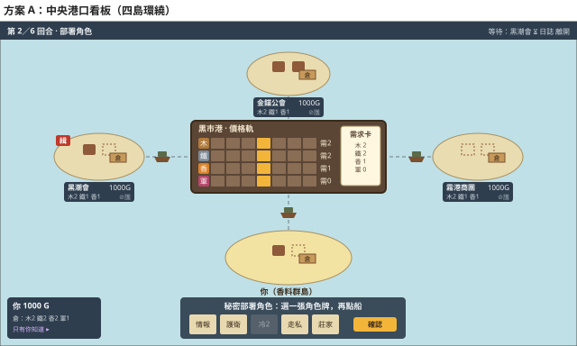
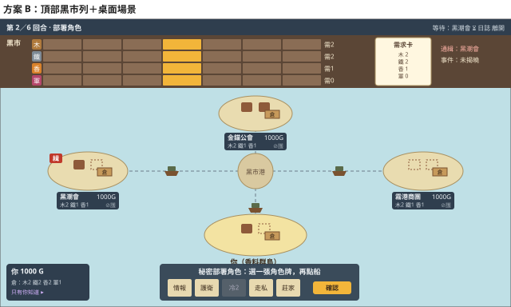
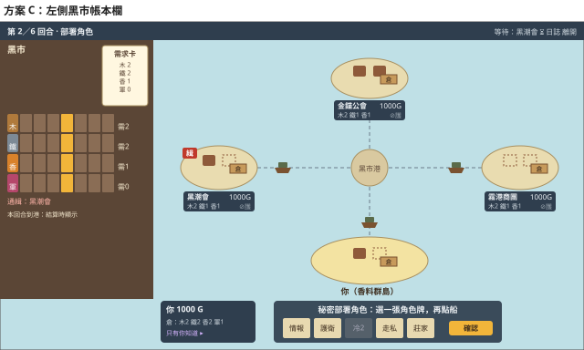

# V0.7 桌面版面研究與方案比較（階段 5c 前置）

> 狀態：草案（2026-10-12），**等使用者選定方案**後才實作 2D 版位草圖。本文件只討論「資訊放哪裡、怎麼呈現」，不涉及規則；規則以 [`game-design.md`](../game-design.md) 為準，文中提到的規則內容只是重述。
> 截圖與草圖在 [`v07-layout/`](v07-layout/)；草圖由 `node docs/ui/v07-layout/sketch.mjs docs/ui/v07-layout` 產生。

## 1. V0.6 介面：實際操作觀察

在開發伺服器 `/` 以單機 1 對 3 操作第 1 回合（購買資產 → 合資 → 出航 → 部署海盜 → 結算），截圖：
[購買](v07-layout/v06-buy.jpg)、[部署](v07-layout/v06-deploy.jpg)、[角色揭露](v07-layout/v06-reveal.jpg)、[結算](v07-layout/v06-result.jpg)。
對照：[V0.7 目前的純面板](v07-layout/v07-panel-invest.jpg)。

**V0.6 的版面：**

- 3D 桌面佔滿全畫面。黑市港在中央，四座玩家島環繞，自己的島在最靠近鏡頭的位置。每座島到中央都有一條玩家顏色的虛線航道。
- 頂端左側是回合數和兩張事件卡（羊皮紙），頂端右側是日誌和離開。
- 右側是排名欄，每人一張名牌，寫資金、資產與狀態。
- 左下是自己的帳本：資金、資產、黑錢。
- 底部置中是決策列，手牌站在決策列正上方。

**值得沿用：**

| 設計 | 理由 |
| --- | --- |
| 中央港口＋四島環繞、自己在前 | 船「從自己的島開往黑市」的因果一眼就懂；V0.7 的價格也是由到港量決定，空間關係剛好對上。 |
| 角色卡牌列＋「先選牌、再點海上的船」＋確認 | 部署很直覺，V0.7 的五個角色可以直接套用。 |
| 角色揭露後，卡片立在各島旁 | 一張圖就看懂誰派了誰去打哪艘船，不用讀日誌。 |
| 船名牌上的骰子逐步套用修正（例：5 → 海盜 −1 → 4），最後變綠或紅 | V0.7 的修正順序（§9.1）一樣，可以沿用 `dieSteps`。 |
| 只有你看得到的卡用紫色緞帶 | 已經是私密資訊的視覺語言，同機輪流換人時隱藏。 |
| 事件卡翻開的演出、天氣換海面 | 航海事件（§12）沿用。 |
| 現金浮字 | V0.7 的收支項目更多（§5 第 8 步共 8 種），浮字比讀日誌好懂。 |

**因為 V0.7 規則不同，要重新設計：**

| V0.7 新元素 | V0.6 沒有、或要改的地方 |
| --- | --- |
| **4 條價格軌（7 格）＋需求卡**（§7） | V0.6 沒有市場。這是 V0.7 最核心的公開資訊，每回合投資前都要看，必須「掃一眼就懂」。 |
| **倉庫**（§6.3，生產後公開） | V0.6 沒有材料。對手的倉庫是猜測裝貨的依據（§14 驗證問題 1），所以不能藏起來。 |
| **裝貨（保密）→ 結算時翻開** | V0.6 的船沒有貨。現在船上要有「蓋著的貨」，到結算才翻開。 |
| **最多 2 棟建築**（§10.1） | V0.6 的建築沒有上限。島上可以固定 2 個地基，空地基本身就表示「還能蓋」。 |
| **通緝**（§9.6） | 新的公開標記，海盜要看。 |
| **角色冷卻**（§9.3） | 自己手牌的冷卻角色要變灰並標示剩幾回合。對手的冷卻也是公開資訊，可以放在名牌上，用來推測對手能派什麼。 |
| **莊家**（選商品與方向） | 不鎖定船，所以要直接點價格軌上的那一行，加漲／跌。 |
| **合資招募**（V0.6 專屬） | 整套刪除：羊皮紙、信鴿、握手、撕信封。 |
| **市場事件卡** | 由需求卡取代（§12 最後一點），頂端只剩航海事件一張。 |

## 2. 其他遊戲的做法（網路研究摘要）

只摘要做法，沒有複製任何美術或文字。

**2.1 價格軌與需求放在哪**

- BGA 的開發指引：共用的行動區放中央，全域資訊放上方或下方，私有資源放在 player panel。100% 縮放時就要能完整遊玩，主版圖盡量一次看得到。[^bga]
- 《Dominant Species》數位版：主地圖佔大部分畫面，次要面板做成從邊緣滑出的 tab，不用彈出視窗。[^ds]
- 《Terraforming Mars》數位版：全域參數軌圍繞在中央的火星周圍。[^tm]
- 《Offworld Trading Company》：價格欄放在畫面左側，每種資源一行。玩家抱怨要逐項 hover 才看得到價格，希望一眼看完所有價格與漲跌趨勢。[^owtc]
  - 給我們的教訓：價格軌不能做成要點開才看得到。

**2.2 自己與對手的個人區**

- BGA：player panel 要精簡（手機上 4 人加起來約佔 1/4 畫面），只放顏色、分數、資源；完整版圖放在下面，需要時才捲動過去看。[^bga]
- 《Terraforming Mars》數位版：預設顯示自己，點對手的名字才切換成對方的版圖；玩家板濃縮成「圖示＋數字」。[^tm]
- 《7 Wonders》App：自己佔大部分畫面，左右兩側用小面板顯示相鄰對手。[^7w]

**2.3 船與貨物**

- 實體《Container》：每人一艘船，貨櫃直接放在船上，看得見載了什麼。[^container]
- V0.7 的不同：貨要保密到結算，所以適合用「蓋著帆布的貨箱」，結算時再掀開。

**2.4 同時秘密決定**

- BGA 的同時行動階段：已提交的玩家變灰（inactive），只顯示誰已完成，不顯示選了什麼。[^bgajs]
  - 有玩家回報：若看得到別人在選什麼，就會有人等別人先選。[^bgabug]
- webDiplomacy 把狀態分成三種：還沒下令、已暫存、已確認（社群描述，非官方文件）。[^webdip]
- 《7 Wonders》App 一次揭示所有人的選擇，有評論希望能逐步揭示，因為一次全揭看不清楚發生了什麼。[^7wslow]
  - V0.7 規則已明定「等待中的決定」公開（§4），我們只顯示「誰還沒決定」，與上述做法一致。

**2.5 冷卻與狀態**

- 《Terraforming Mars》數位版：不能出的手牌加陰影，有條件的牌加標籤。[^tm]
- BGA：tooltip 只放補充細節，不要把遊戲元件藏進彈出視窗。[^bga]

**查不到可信資料的部分：** 《Container》《Brass》《Power Grid》《Libertalia》的數位版面描述。這些沒有寫進結論。

## 3. 版面方案

三個方案的共同點：

- 底部是決策列與手牌，沿用 V0.6。冷卻中的角色變灰並標「冷 n」。
- 左下是自己的帳本：現金、倉庫的確切數量、「只有你知道」入口。
- 頂端列放回合、階段、航海事件，以及「還在等誰」（§4，公開）。
- 自己的島在前方、放大，島上有 2 個建築地基（空的用虛線）和倉庫木箱。
- 對手名牌的內容：現金、倉庫數量（生產後公開）、冷卻中的角色。被通緝者的島與名牌加紅色「緝」標記。
- 船停在航道上，貨物用蓋著的貨箱表示，結算時翻開。
- 燈塔島多看的那艘船：角色揭露時只在該船名牌加一個淡色小眼睛，不加演出（依使用者指示低調呈現）。

### 方案 A：中央港口看板（四島環繞）

黑市港本身就是一塊看板：4 條價格軌（7 格）在左，需求卡在右。每一行的尾端標「需 n」。

- 結算時，在同一行加上「到 m」和漲跌箭頭。這樣「到港量 vs 需求 → 價格變動」（§7.3）在同一行就能比較。
- 莊家：直接點看板上的一行，選漲或跌。

| 優點 | 缺點 |
| --- | --- |
| 場景優先：黑市就在船要去的地方，價格變動的因果最清楚。 | 看板佔掉中央空間，航道變短，船名牌和骰子容易擠到看板邊緣。 |
| 價格是全局最重要的資訊，放在視線中心（BGA、TM 都把共用版圖放中央）。 | 若做成 3D 物件，有透視時小字會糊。實作上要把看板當成 DOM 標籤釘在港口上（同 `SceneLabels`），不會跟著透視縮小。 |
| 之後換 3D 資產時，看板本身就是一個很好的場景道具（木製告示板）。 | 手機橫式（高約 375px）放不下中央看板，要另外準備窄版（例如退回方案 C 的側欄）。 |

### 方案 B：頂部黑市列＋桌面場景

價格軌橫跨整個頂端，需求卡、通緝、航海事件排在右側。中央港口只是一座小島。

| 優點 | 缺點 |
| --- | --- |
| 最好讀：格子大、不受鏡頭影響，和現在的面板最接近，改動最小。 | 吃掉頂端約 18% 高度，就是目前手機橫式「市場列太佔高度」的問題。 |
| 價格一眼看完，避開 Offworld 的抱怨。 | 黑市和港口分開，船開到中央時，價格的變化在畫面另一端，視線要上下跳。 |
| 場景只剩島和船，鏡頭取景單純。 | 場景感較弱，比較像「面板加背景圖」。 |

### 方案 C：左側黑市帳本欄

左側一整欄放黑市：需求卡在上，4 條價格軌在下，再下面是通緝與「本回合到港」。場景佔右側約 3/4。

| 優點 | 缺點 |
| --- | --- |
| 寬螢幕的橫向空間多，側欄不壓縮高度；**手機橫式也適用**（高度不夠、寬度夠）。 | 場景變窄，四座島的間距縮小。 |
| 價格與需求都在同一欄，查閱方便；Offworld 的價格欄也放在側邊。 | 和港口的空間關聯同樣較弱（同方案 B）。 |
| 側欄可以收合（參考《Dominant Species》的邊緣 tab），收起後就是純場景。 | 收合後要有地方顯示最小資訊，例如頂端的 4 個價格數字。 |

## 4. 建議

**建議採用方案 A（中央港口看板）作為桌面版，手機橫式改用方案 C 的側欄。**

**黑市價格軌與需求卡放在哪：** 放在畫面中央的港口看板上。

- 價格軌放在左，需求卡放在右。
- 每條價格軌的尾端直接標本回合需求；結算時在同一行標到港量與漲跌。

理由：

1. **對上 V0.7 的核心循環。** 規則的中心是「大家把貨運到同一個港口，擠同一種貨價格就崩」（§1、§7.3）。把價格放在船要去的地方，到港、比需求、價格移動，全部發生在同一個位置，演出（5d）也最自然。
2. **延續既有方向。** 使用者先前定的是「場景優先」，V0.6 的中央港口與四島環繞也已經驗證好用；方案 A 只是把港口換成看板，其他版位幾乎不動。
3. **可讀性用 DOM 解決。** 看板當成釘在港口上的 DOM 標籤，字級不受 3D 透視影響。之後換成 3D 告示板模型時，格子與數字仍維持 DOM。
4. **手機另外處理。** 方案 C 的側欄在高度不夠時最省空間。版面由 `useLayout` 的 `landscape` 切換，和 V0.6 的做法相同。

**選 A 時，2D 版位草圖要先驗證的事：**

- 1280×720 時，看板加上四座島與船名牌，是否不重疊。
- 結算時看板上同時出現「需 n、到 m、箭頭」是否還讀得懂。
- 3 人局時的三角形排列。

**若使用者更重視可讀性與改動量，B 是最保守的選擇**，但手機橫式的問題會留著。

## 5. 待確認（不涉及規則）

- 對手冷卻中的角色是否要顯示在名牌上？規則上這是公開資訊（§4），但會增加名牌的資訊量。
- 價格軌的格子要顯示金額（75～225 G），還是只顯示格位，金額放在 tooltip？
  - 建議顯示目前價格的金額，其他格子只顯示格位。

[^bga]: BGA Studio Guidelines — https://en.doc.boardgamearena.com/BGA_Studio_Guidelines
[^bgajs]: BGA Game interface logic — https://en.doc.boardgamearena.com/Game_interface_logic:_yourgamename.js
[^bgabug]: BGA bug #74757 — https://gl.boardgamearena.com/bug?id=74757
[^ds]: (Re) Designing the User Interface for Digital Dominant Species（GMT） — https://insidegmt.com/re-designing-the-user-interface-for-digital-dominant-species
[^tm]: Terraforming Mars Digital review（Meeple Mountain） — https://meeplemountain.com/reviews/terraforming-mars-digital
[^owtc]: Offworld Market Prices View（Stardock 論壇） — https://www.stardock.com/games/article/462069/offworld-market-prices-view
[^7w]: Review: 7 Wonders (iPad)（Destructoid） — https://destructoid.com/reviews/review-7-wonders-ipad
[^7wslow]: Review: 7 Wonders（Stately Play） — https://statelyplay.com/2017/11/14/review-7-wonders/
[^container]: Container (board game)（Wikipedia） — https://en.wikipedia.org/wiki/Container_(board_game)
[^webdip]: webDiplomacy ready 圖示（Straight Dope 論壇，非官方） — https://boards.straightdope.com/t/diplomacy/819132?page=2

## 6. 焦點層與演出節奏（2026-10-12 追加）

使用者回饋：V0.6 結算時資訊一直跳，雖然熱鬧但很難讀。第 3 節的方案只決定「平常時桌面放什麼」，這一節處理「事情發生時怎麼呈現」。三個版面方案都適用。

### 6.1 原則：桌面＋焦點層

- **桌面（常駐）：** 只放掃一眼就懂的東西，例如價格、現金、倉庫數量、誰還沒決定。不放說明，也不放動畫細節。
- **焦點層（一次一張）：**
  - 需要閱讀、需要決定、或跟自己有關的事，變成畫面中央的大卡。
  - 背景桌面壓暗並模糊，但輪廓仍看得到。
  - 適用的時刻：選島、選角色、情報重擲，以及結算的每一拍。
- **結算一拍一件事：**
  - 順序是：回合開始卡 → 航海事件卡 → 每艘船一拍 → 市場一拍 → 本回合帳單。
  - 和自己有關的拍要完整播放；對手之間的事壓縮帶過（之後再決定怎麼壓縮）。
  - 每一拍會自己往下播，點一下可以前進；也有「再看一次」與「跳到結果」。
- **參考對象分工：**
  - 資訊的組織方式參考數位桌遊（BGA、《Terraforming Mars》）。
  - 時刻的演出參考卡牌遊戲（《殺戮尖塔》的選卡、Balatro 的計分）。
  - 理由：我們有 4 人同時秘密決定加共用市場，資訊結構是桌遊；但數位桌遊在「好讀的演出」上很少有好範例。
- **戰鬥演出要象徵化、不要做成戰鬥：**
  - 船沉不沉是骰子決定的，玩家不能介入。做成長戰鬥只會拖慢節奏，也會讓人以為能操作。
  - 每個角色做一個短動作，代表它的修正值：海盜開一砲讓骰子 −1，護衛擋在前面讓骰子 +1。
  - 這樣演出本身就是規則說明。

### 6.2 小丑牌（Balatro）的演出分析

**資料來源與可信度：**

- 依據是一篇外部的設計分析[^balatro]，不是開發者的文件。
  - 文中的毫秒數、像素數是作者的重建，只能當數量級參考。
  - 文中說「整段只要約 300 ms」，和實際遊玩時一次計分要好幾秒的觀感不符，**不採用**。
- 實際的動畫速度選項，那篇分析沒有提到。

**它為什麼資訊多卻讀得懂：**

| 手法 | 做法（摘要） | 我們怎麼用 |
| --- | --- | --- |
| **依序觸發** | 牌型先列出基礎數值，再由左到右一個一個觸發加成；每觸發一次，累計值就更新一次。 | 骰子從起始值開始，依規則 §9.1 的順序逐項套用修正，每一項都是獨立的一拍。 |
| **累計值永遠看得到** | 籌碼與倍率的數字一直在畫面上，每一步都在原地改變。 | 大骰子固定在右側，旁邊是 1～6 的刻度（1～3 沉沒、4～6 抵達），看得出離門檻多遠。 |
| **數字有動態** | 數字像拉霸滾動、略為過衝再定位。 | 每次骰值改變，骰子都翻滾一下再定位。 |
| **震動代表大小** | 分數越大，畫面震得越大越久；還沒讀到數字就先感覺到差距。 | 骰子震動強度依修正值大小；海盜命中時，船被打得晃一下。 |
| **顏色就是標籤** | 籌碼藍、倍率紅、金錢金，不用看文字也知道是哪一類。 | 綠色代表加、紅色代表減。之後收入、支出、貨物也各固定一種顏色。 |
| **回饋強度隨重要性變化** | 小事小動，大事大動。 | 自己的船、自己出的角色做完整演出，對手之間的事縮小。 |
| **多個感官管道疊加** | 牌、數字、畫面、粒子、音效同時出現，但各自傳達不同的資訊。 | 目前只有畫面。音效（例如骰子落定、砲聲、蓋章）是之後可以加的一層，見 [`backlog.md`](backlog.md) 第 3 節。 |

**不適合照搬的地方：**

- Balatro 是單人遊戲，一次只有一個計分來源。我們有 4 艘船，所以要「一艘船一拍」，不能全部同時演。
- Balatro 的回饋是給自己的獎勵感；我們的結算常常是「別人的船被打沉」。對手之間的事要壓縮，不能每件都放大。

### 6.3 試驗：一艘船的結算拍

開發預覽頁：`/v07.html?dev=beat`，可加 `&seed=7` 換一局。

- **資料來源：** 用 seed 跑一局全 Bot 對局，只讀公開事件，左上角可以選任何一艘已結算的船。
- **檢視者：** 第一個座位當作「你」。
- 對應的程式在 `src/ui-v07/beats/` 與 `src/ui-v07/dev/BeatPreview.tsx`。

**一拍的順序：**

1. 出航。
2. 起始骰值。若情報商人重擲過，標題旁會註明。
3. 修正逐項套用。每一步一個角色道具進場，例如海盜從右側進場、開砲，船被打得晃一下；骰子翻滾成新值，刻度跟著移動。
4. 「抵達／沉沒」蓋章：船駛離，或傾斜沉下去。
5. 掀開船上的貨。
6. 每筆金流一行一行跳出，和你有關的行用金框標出。保險與打撈的貨也在這裡列出。
7. 按「繼續」後出現**本回合帳單**：你這回合每一種收支一行，最後一行是合計。就算整段演出都跳過，看帳單也能知道發生了什麼。

**驗證（開發伺服器）：**

- 1440×900：卡片高度固定，內容陸續出現時不會跳動。
- 812×375（手機橫式）：整張卡連底部按鈕都放得下，不需要捲動。
- 測試 `tests/ui-v07/shipBeat.test.ts` 確認以下幾點：
  - 每一拍的修正合計與引擎的 `voyage-modifiers` 相同。
  - 列出的護衛／海盜與揭露的部署一致。
  - 金流合計與現金異動相同。
  - 帳單合計等於該回合的現金變化。
  - 時間軸依規則順序、一次只出現一件事。

**待使用者試看後決定：**

- 節奏：目前一拍約 6～9 秒，數值集中在 `BEAT_PACE`。
- 道具是否改用 SVG 輪廓擠出的 3D 模型；目前是文字符號佔位。
- 對手之間的船要怎麼壓縮：只播結果，或幾艘合成一張卡。

[^balatro]: Balatro 設計分析（Blake Crosley，非官方） — https://blakecrosley.com/guides/design/balatro

### 6.4 試驗：在 3D 桌面上播同一拍（2026-10-13）

使用者希望保留 V0.6 調了很久的天氣演出，所以「場景模式」的一拍直接在 3D 桌面上試，沒有先做 2D 方塊版。

- **預覽頁：** `/v07.html?dev=beat3d`。
  - `&seed=7` 換一局。
  - `&weather=storm` 強制換海況，但結算骰值仍照該回合實際的事件。
- **沿用 V0.6 的元件（直接引用 `src/ui/scene`，未複製）：**
  - 海、浪花、雲。
  - 六種天氣：暴風雨、順風、海霧、月黑風高、黑市熱絡、風平浪靜。
  - 島、黑市港、航道、船。
  - 沉船水花、預先編譯著色器（`EffectWarmup`）。
- **新寫的部分（`src/ui-v07/scene/`）：**
  - `FocusCamera` 與 `focusMath`：
    - 和 V0.6 一樣的固定俯角，但鏡頭可以左右平移；V0.6 的鏡頭只能前後移。
    - 拍子開始時推到那艘船，讓船置中在面板左邊的空間；拍子結束後拉回全景。
  - `beatStage`：純函式，決定場面怎麼演。
    - 哪些角色已經進場：海盜、護衛各自隨自己那一步進場，之後一直留在船邊。
    - 船對這一步的反應：海盜開砲、暴風雨打閃電、順風往前推、其他加值往上抬、其他減值震一下。
    - 哪些島跟這拍有關：船東、海盜、護衛的島會亮起呼吸光圈，其他島的名牌變淡。
  - `BeatScene`：組裝場景，骰子和 1～6 刻度浮在船的上方。
  - 解說面板改為靠右停靠（`BeatCard` 的 `docked` 模式），顯示步驟、算式、貨物、金流。
- **截圖：**
  - [海盜進場（順風回合）](v07-layout/beat3d-pirate.jpg)
  - [順風 +1](v07-layout/beat3d-tailwind.jpg)
  - [抵達](v07-layout/beat3d-arrived.jpg)
  - [月黑風高的夜裡被擊沉](v07-layout/beat3d-sunk-night.jpg)
  - 對照：[滿版卡版本](v07-layout/beat-card.jpg)

**實測中發現並修正的問題：**

- 播放時鐘原本每一幀都更新 React 狀態，整個 3D 場景每一幀都重繪，海盜船也每幀被拉回出發點。改成只有進入下一步時才更新狀態。
- 模型還沒載完，拍子就先播完了。改成等 `EffectWarmup` 完成後才開始播。

**還沒做、等使用者看過再決定：**

- 暴風雨的閃電目前只是一道亮光柱。要不要接上 `Storm` 原本的閃電？
- 海霧、月黑風高這兩步沒有專屬演出，現在共用「抬一下／震一下」。
- 走私、軍火沒收、保險、打撈還沒有場面，只寫在面板上。
- 跟這拍無關的島目前只把名牌變淡，島本身沒有變暗。
- 手機版面還沒處理。
- 骰子標籤在船駛向港口時不會跟著移動。

**2026-10-13 修正：資訊跟著焦點走。**

- **使用者回饋：** 骰子在船上、說明在右側面板，反而不知道要看哪裡。
- **原則：** 同一刻的資訊只能有一個位置。
- **改法：**
  - 拿掉右側面板。
  - 骰子、1～6 刻度、這一步的名稱和數值、出手的人、算式、結果章、貨物、金流，全部集中在船上方的同一張小卡（`BeatTag`），小卡有箭頭指向船。
  - 海盜、護衛改停在船的前方兩側（靠鏡頭那一側），不會被小卡擋住。
  - 操作按鈕縮成底部一條小列；點畫面任何地方也能前進。
- **截圖：** [順風那一步](v07-layout/beat3d-tag.jpg)、[擊沉後](v07-layout/beat3d-tag-sunk.jpg)。
- **之後所有時刻都照這條原則：** 演出在哪裡，文字就在哪裡。
